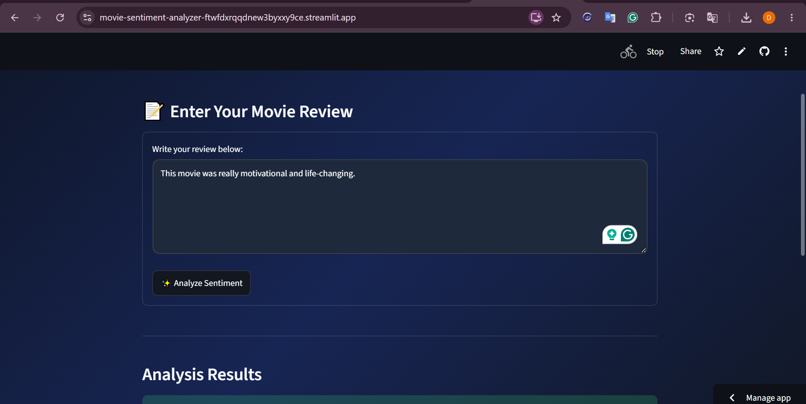
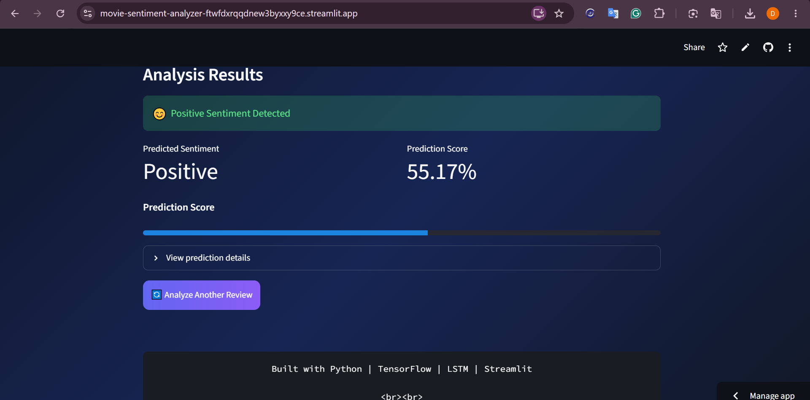

<div align="center">

# Movie Sentiment Analyzer

### LSTM-based movie review classification with TensorFlow/Keras and Streamlit

<p>
  <a href="https://movie-sentiment-analyzer-ftwfdxrqqdnew3byxxy9ce.streamlit.app">
    <strong>🚀 Try the live application</strong>
  </a>
  &nbsp;·&nbsp;
  <a href="https://github.com/chauhanhimans7-bot/movie-sentiment-analyzer">
    View source on GitHub
  </a>
</p>


</div>

---

## Live Demo

**The application is deployed on Streamlit Community Cloud.** Open the link below, enter a movie review, and select **Analyze Sentiment** to see the model's prediction.

### [Open Movie Sentiment Analyzer →](https://movie-sentiment-analyzer-ftwfdxrqqdnew3byxxy9ce.streamlit.app)

> The application predicts whether an entered review expresses **Positive** or **Negative** sentiment. The displayed prediction score is derived from the model's sigmoid output; it is not a calibrated guarantee of real-world certainty.

## Application Preview

### Review input



### Sentiment prediction



---

## Overview

Movie Sentiment Analyzer is an end-to-end natural language processing project that classifies movie reviews as **Positive** or **Negative**.

The project covers the full workflow:

1. Downloading and inspecting the IMDb movie-review dataset.
2. Cleaning and preparing review text.
3. Converting text into token sequences and padding them to a fixed length.
4. Building and training an LSTM-based binary classifier.
5. Evaluating the model on a held-out test set.
6. Saving the trained model and tokenizer.
7. Integrating the saved artifacts into a Streamlit application.
8. Deploying the application so it can be tested through a public URL.

The trained model is loaded for inference. Users do not need to retrain it to classify a new review.

## Features

- **Binary sentiment classification:** predicts Positive or Negative sentiment.
- **Interactive Streamlit interface:** accepts free-form movie reviews.
- **Consistent preprocessing:** applies the same text-cleaning and tokenization pipeline used during training.
- **Saved model artifacts:** loads the trained Keras model and fitted tokenizer.
- **Prediction details:** displays the predicted class and its model-derived score.
- **Public deployment:** hosted on Streamlit Community Cloud.
- **Reproducible training workflow:** includes the notebook used for dataset preparation, model training, and evaluation.

## Dataset

The project uses the [IMDb Dataset of 50K Movie Reviews](https://www.kaggle.com/datasets/lakshmi25npathi/imdb-dataset-of-50k-movie-reviews), sourced from Kaggle.

| Attribute | Details |
|---|---|
| Original dataset size | 50,000 reviews |
| Text column | `review` |
| Target column | `sentiment` |
| Sentiment classes | `negative`, `positive` |
| Records after duplicate removal | 49,582 |
| Training samples | 39,665 |
| Testing samples | 9,917 |

The dataset itself is not included in this repository. The training notebook contains the workflow used to download it. Configure Kaggle authentication in your own environment when rerunning the dataset-download cells. **Never commit `kaggle.json`, API tokens, or other credentials.**

## Model Development

### 1. Data preparation

The notebook performs the following preprocessing steps:

- Removes duplicate records and resets the DataFrame index.
- Converts review text to lowercase.
- Decodes HTML entities.
- Removes HTML tags and URLs.
- Normalizes repeated whitespace.
- Maps sentiment labels to numeric values:
  - `negative` → `0`
  - `positive` → `1`
- Splits the data into training and testing sets using an 80/20 stratified split with `random_state=42`.

Stopwords are not removed. In particular, negation words such as `not`, `never`, and `no` are retained because they can change a review's sentiment.

### 2. Tokenization and sequence preparation

A Keras `Tokenizer` is fitted on the training reviews only.

| Setting | Value |
|---|---:|
| Vocabulary limit | 10,000 |
| Out-of-vocabulary token | `<OOV>` |
| Maximum sequence length | 600 |
| Padding | Post-padding |
| Truncation | Post-truncation |

The sequence length of 600 was selected after inspecting the training-review length distribution: the 95th percentile was approximately 588 tokens. Reviews shorter than 600 tokens are padded; longer reviews are truncated.

The fitted tokenizer is saved as `tokenizer.json` and reused by the application during inference.

### 3. LSTM architecture

The model uses the following Keras architecture:

| Layer | Configuration | Role |
|---|---|---|
| Input | Sequence length `600` | Receives token IDs |
| Embedding | `input_dim=10000`, `output_dim=128`, `mask_zero=True` | Maps token IDs to dense vectors |
| LSTM | `64` units | Learns sequential patterns in review text |
| Dropout | `0.3` | Applies dropout during training |
| Dense | `1` unit, sigmoid activation | Produces the positive-class probability |

### 4. Training configuration

| Parameter | Value |
|---|---|
| Optimizer | Adam |
| Loss | Binary cross-entropy |
| Metric | Accuracy |
| Maximum epochs | 5 |
| Batch size | 32 |
| Validation split | 10% of training data |
| Early stopping | Monitors `val_loss` |
| Early-stopping patience | 2 |
| Best weights | Restored using `restore_best_weights=True` |

Early stopping halted training after three epochs because validation loss did not improve for two consecutive epochs. The best-performing weights were restored.

## Evaluation

Evaluation was performed on the held-out test set of **9,917 reviews**.

<div align="center">

| Test metric | Result |
|---|---:|
| **Accuracy** | **86.58%** |
| Test loss | 0.3183 |

</div>

### Classification report

| Class | Precision | Recall | F1-score | Support |
|---|---:|---:|---:|---:|
| Negative | 0.90 | 0.83 | 0.86 | 4,940 |
| Positive | 0.84 | 0.91 | 0.87 | 4,977 |
| Macro average | 0.87 | 0.87 | 0.87 | 9,917 |
| Weighted average | 0.87 | 0.87 | 0.87 | 9,917 |

### Confusion matrix

Rows represent actual classes and columns represent predicted classes. Class order: Negative (`0`), Positive (`1`).

| Actual \ Predicted | Negative | Positive |
|---|---:|---:|
| **Negative** | 4,077 | 863 |
| **Positive** | 468 | 4,509 |

The results show that the model identifies positive reviews with higher recall (0.91) and negative reviews with higher precision (0.90). These metrics are specific to the held-out test split and should not be interpreted as a guarantee for all future inputs.

## Repository Structure

```text
Movies sentiment analyzer/
│
├── app.py
├── test_model.py
├── requirements.txt
│
├── sentiment_model.keras
├── tokenizer.json
│
└── notebook/
    └── Sentiment_Analysis_Using_DL.ipynb
```

| File | Description |
|---|---|
| `app.py` | Streamlit interface and sentiment-prediction flow |
| `test_model.py` | Loads the saved artifacts and tests a sample prediction |
| `sentiment_model.keras` | Trained LSTM model |
| `tokenizer.json` | Fitted Keras tokenizer |
| `requirements.txt` | Python dependencies |
| `notebook/Sentiment_Analysis_Using_DL.ipynb` | Dataset preparation, training, and evaluation notebook |

The screenshots displayed above are stored in `assets/screenshots/` in this repository.

## Run Locally

### Prerequisites

- Python and pip
- Git
- The model and tokenizer files included in this repository

### 1. Clone the repository

```bash
git clone https://github.com/chauhanhimans7-bot/movie-sentiment-analyzer.git
cd movie-sentiment-analyzer
```

### 2. Install dependencies

```bash
python -m pip install --upgrade pip
python -m pip install -r requirements.txt
```

Use a Python version compatible with the TensorFlow dependency specified in `requirements.txt`.

### 3. Start the Streamlit application

```bash
python -m streamlit run app.py
```

Open the local URL printed by Streamlit, typically:

```text
http://localhost:8501
```

### 4. Test the model separately (optional)

```bash
python test_model.py
```

This script loads the saved model and tokenizer, processes a sample review, and prints the predicted sentiment and score.

## Inference Workflow

For each review submitted in the application:

1. Clean the input text using the training-time preprocessing rules.
2. Convert the cleaned text into token IDs using the saved tokenizer.
3. Pad or truncate the sequence to 600 positions.
4. Run the sequence through the trained LSTM model.
5. Apply a `0.5` threshold to the sigmoid output:
   - Output `>= 0.5` → Positive
   - Output `< 0.5` → Negative
6. Display the predicted sentiment and the score for the selected class.

## Limitations

- This is a binary classifier trained on IMDb movie reviews. Performance may differ on other domains, short snippets, sarcasm, mixed sentiment, or text unlike the training data.
- Reviews longer than 600 tokens are truncated.
- The prediction score is derived from the sigmoid output and is not necessarily a calibrated probability of correctness.
- Reported evaluation metrics correspond to the held-out test split used in the notebook.
- The dataset is not bundled with the repository; Kaggle access is needed to reproduce the original download step.

## Technologies

- Python
- TensorFlow / Keras
- LSTM
- Streamlit
- NumPy
- Pandas
- Scikit-learn
- Matplotlib
- Seaborn
- Kaggle
- Jupyter Notebook / Google Colab

---

<div align="center">

**Built as an end-to-end deep learning project — from model training to a deployed interactive application.**

[Live Demo](https://movie-sentiment-analyzer-ftwfdxrqqdnew3byxxy9ce.streamlit.app) · [GitHub Repository](https://github.com/chauhanhimans7-bot/movie-sentiment-analyzer)

</div>
