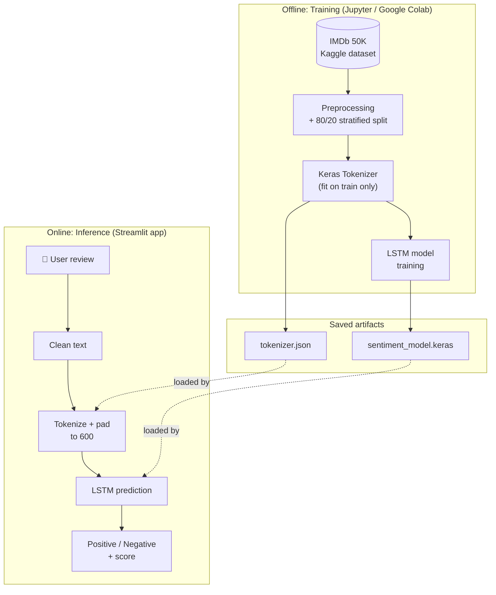
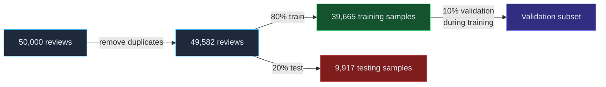
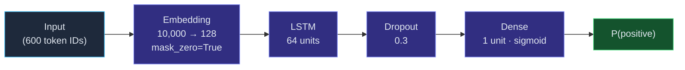
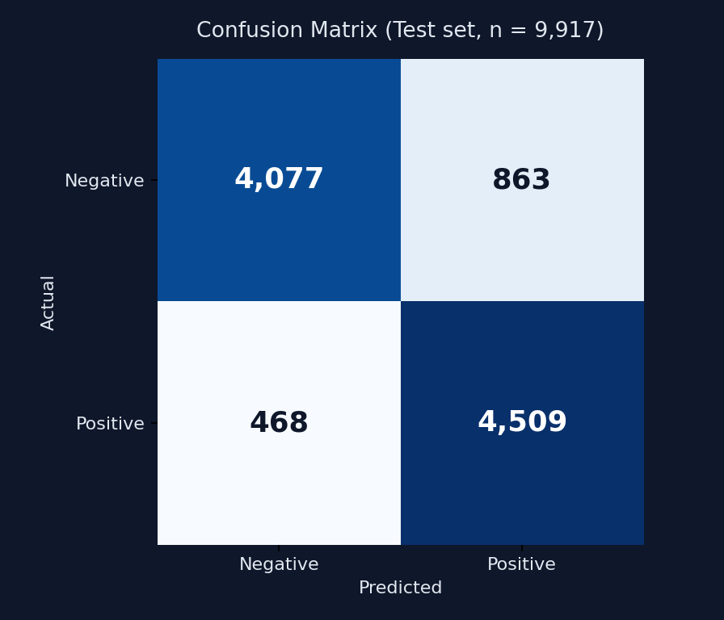
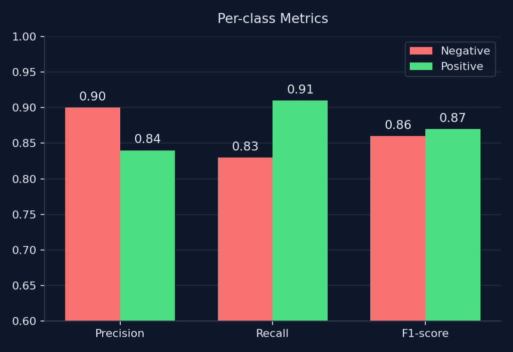
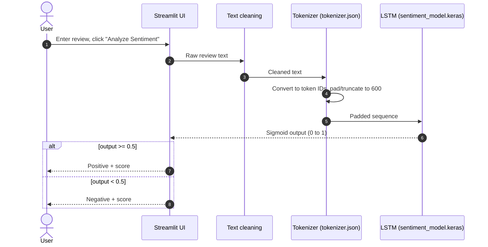

<div align="center">

# 🎬 Movie Sentiment Analyzer

### End-to-end LSTM sentiment classification on IMDb reviews, deployed with Streamlit

<p>
  <a href="https://movie-sentiment-analyzer-ftwfdxrqqdnew3byxxy9ce.streamlit.app"><strong>🚀 Live Demo</strong></a>
  &nbsp;·&nbsp;
  <a href="https://github.com/chauhanhimans7-bot/movie-sentiment-analyzer"><strong>📂 Source Code</strong></a>
  &nbsp;·&nbsp;
  <a href="#model-development"><strong>🧠 Model Details</strong></a>
</p>


</div>

---

## 📑 Table of Contents

- [Live Demo](#-live-demo)
- [Application Preview](#-application-preview)
- [Overview](#-overview)
- [Key Results](#-key-results)
- [System Architecture](#-system-architecture)
- [Features](#-features)
- [Dataset](#-dataset)
- [Model Development](#model-development)
- [Evaluation](#-evaluation)
- [Inference Workflow](#-inference-workflow)
- [Repository Structure](#-repository-structure)
- [Run Locally](#-run-locally)
- [Limitations](#-limitations)
- [Technologies](#-technologies)

---

## 🚀 Live Demo

The application is deployed on **Streamlit Community Cloud**. Open the link, enter a movie review, and select **Analyze Sentiment** to see the model's prediction.

<div align="center">

### [▶ Open Movie Sentiment Analyzer](https://movie-sentiment-analyzer-ftwfdxrqqdnew3byxxy9ce.streamlit.app)

</div>

> [!NOTE]
> The application predicts whether a review expresses **Positive** or **Negative** sentiment. The displayed prediction score comes from the model's sigmoid output; it is **not** a calibrated guarantee of real-world certainty.

---

## 🖼 Application Preview

<table>
  <tr>
    <td align="center" width="50%">
      
      <br />
      <sub><b>1 · Review input</b><br />Paste or type any movie review and click <i>Analyze Sentiment</i>.</sub>
    </td>
    <td align="center" width="50%">
      
      <br />
      <sub><b>2 · Sentiment prediction</b><br />Predicted class, model score, and expandable prediction details.</sub>
    </td>
  </tr>
</table>

---

## 📌 Overview

Movie Sentiment Analyzer is an end-to-end natural language processing project that classifies movie reviews as **Positive** or **Negative**. It covers the full workflow, from raw data to a public web application.


The trained model is loaded for inference, so users do **not** need to retrain it to classify a new review.

---

## 🏆 Key Results

<div align="center">

| Test Accuracy | Test Loss | Test Samples | Vocabulary | Max Sequence Length |
|:---:|:---:|:---:|:---:|:---:|
| **86.58%** | **0.3183** | **9,917** | **10,000** | **600** |

</div>

---

## 🏗 System Architecture

The project has two phases: an **offline training phase** (notebook) that produces the saved artifacts, and an **online inference phase** (Streamlit app) that consumes them.



---

## ✨ Features

| | Feature | Description |
|---|---|---|
| 🎯 | **Binary sentiment classification** | Predicts Positive or Negative sentiment. |
| 💬 | **Interactive Streamlit interface** | Accepts free-form movie reviews. |
| 🔁 | **Consistent preprocessing** | Applies the same cleaning and tokenization pipeline used during training. |
| 💾 | **Saved model artifacts** | Loads the trained Keras model and fitted tokenizer. |
| 📈 | **Prediction details** | Displays the predicted class and its model-derived score. |
| 🌐 | **Public deployment** | Hosted on Streamlit Community Cloud. |
| 📓 | **Reproducible training** | Includes the notebook for data preparation, training, and evaluation. |

---

## 📚 Dataset

The project uses the [IMDb Dataset of 50K Movie Reviews](https://www.kaggle.com/datasets/lakshmi25npathi/imdb-dataset-of-50k-movie-reviews) from Kaggle.

| Attribute | Details |
|---|---|
| Original dataset size | 50,000 reviews |
| Text column | `review` |
| Target column | `sentiment` |
| Sentiment classes | `negative`, `positive` |
| Records after duplicate removal | 49,582 |
| Training samples | 39,665 |
| Testing samples | 9,917 |



> [!IMPORTANT]
> The dataset is **not** included in this repository. The training notebook contains the download workflow. Configure Kaggle authentication in your own environment before rerunning those cells, and **never commit `kaggle.json`, API tokens, or other credentials.**

---

<a id="model-development"></a>

## 🧠 Model Development

### 1. Data preparation

- Remove duplicate records and reset the DataFrame index.
- Convert review text to lowercase.
- Decode HTML entities.
- Remove HTML tags and URLs.
- Normalize repeated whitespace.
- Map labels to numeric values: `negative` → `0`, `positive` → `1`.
- Split into train and test sets with an **80/20 stratified split** (`random_state=42`).

> [!TIP]
> **Stopwords are intentionally not removed.** Negation words such as `not`, `never`, and `no` are retained because they can flip a review's sentiment.

### 2. Tokenization and sequence preparation

A Keras `Tokenizer` is fitted on the **training reviews only**, which prevents test-set leakage.

| Setting | Value |
|---|---:|
| Vocabulary limit | 10,000 |
| Out-of-vocabulary token | `<OOV>` |
| Maximum sequence length | 600 |
| Padding | Post-padding |
| Truncation | Post-truncation |

The length of 600 was chosen after inspecting the training-review length distribution: the 95th percentile was approximately 588 tokens. Shorter reviews are padded; longer reviews are truncated. The fitted tokenizer is saved as `tokenizer.json` and reused by the app at inference time.

### 3. LSTM architecture



| Layer | Configuration | Role |
|---|---|---|
| Input | Sequence length `600` | Receives token IDs |
| Embedding | `input_dim=10000`, `output_dim=128`, `mask_zero=True` | Maps token IDs to dense vectors |
| LSTM | `64` units | Learns sequential patterns in review text |
| Dropout | `0.3` | Regularizes the model during training |
| Dense | `1` unit, sigmoid activation | Produces the positive-class probability |

### 4. Training configuration

| Parameter | Value |
|---|---|
| Optimizer | Adam |
| Loss | Binary cross-entropy |
| Metric | Accuracy |
| Maximum epochs | 5 |
| Batch size | 32 |
| Validation split | 10% of training data |
| Early stopping | Monitors `val_loss` |
| Early-stopping patience | 2 |
| Best weights | Restored via `restore_best_weights=True` |

Early stopping halted training after **three epochs** because validation loss did not improve for two consecutive epochs. The best-performing weights were restored.

---

## 📊 Evaluation

Evaluation was performed on the held-out test set of **9,917 reviews**.

<div align="center">

| Test metric | Result |
|---|---:|
| **Accuracy** | **86.58%** |
| Test loss | 0.3183 |

</div>

### Classification report

| Class | Precision | Recall | F1-score | Support |
|---|---:|---:|---:|---:|
| Negative | 0.90 | 0.83 | 0.86 | 4,940 |
| Positive | 0.84 | 0.91 | 0.87 | 4,977 |
| Macro average | 0.87 | 0.87 | 0.87 | 9,917 |
| Weighted average | 0.87 | 0.87 | 0.87 | 9,917 |

### Visual summary

<table>
  <tr>
    <td align="center" width="50%">
      
    </td>
    <td align="center" width="50%">
      
    </td>
  </tr>
</table>

### Confusion matrix (raw counts)

Rows are actual classes; columns are predicted classes.

| Actual \ Predicted | Negative | Positive |
|---|---:|---:|
| **Negative** | 4,077 | 863 |
| **Positive** | 468 | 4,509 |

**Interpretation:** the model identifies positive reviews with higher recall (0.91) and negative reviews with higher precision (0.90). It is more likely to label a negative review as positive (863 cases) than the reverse (468 cases). These metrics apply to the held-out test split and should not be read as a guarantee for all future inputs.

---

## 🔄 Inference Workflow



1. Clean the input using the training-time preprocessing rules.
2. Convert the cleaned text to token IDs with the saved tokenizer.
3. Pad or truncate the sequence to 600 positions.
4. Run the sequence through the trained LSTM.
5. Apply a `0.5` threshold to the sigmoid output (`>= 0.5` → Positive, `< 0.5` → Negative).
6. Display the predicted sentiment and the score for the selected class.

---

## 📁 Repository Structure

```text
movie-sentiment-analyzer/
│
├── app.py                      # Streamlit interface and prediction flow
├── test_model.py               # Sanity-check script for the saved artifacts
├── requirements.txt            # Python dependencies
│
├── sentiment_model.keras       # Trained LSTM model
├── tokenizer.json              # Fitted Keras tokenizer
│
├── notebook/
│   └── Sentiment_Analysis_Using_DL.ipynb
│
└── assets/
    ├── screenshots/            # Application preview images
    └── diagrams/               # Evaluation charts
```

| File | Description |
|---|---|
| `app.py` | Streamlit interface and sentiment-prediction flow |
| `test_model.py` | Loads the saved artifacts and tests a sample prediction |
| `sentiment_model.keras` | Trained LSTM model |
| `tokenizer.json` | Fitted Keras tokenizer |
| `requirements.txt` | Python dependencies |
| `notebook/Sentiment_Analysis_Using_DL.ipynb` | Dataset preparation, training, and evaluation notebook |

---

## 💻 Run Locally

**Prerequisites:** Python and pip, Git, and the model and tokenizer files included in this repository.

**1. Clone the repository**

```bash
git clone https://github.com/chauhanhimans7-bot/movie-sentiment-analyzer.git
cd movie-sentiment-analyzer
```

**2. Install dependencies**

```bash
python -m pip install --upgrade pip
python -m pip install -r requirements.txt
```

> Use a Python version compatible with the TensorFlow version pinned in `requirements.txt`.

**3. Start the Streamlit app**

```bash
python -m streamlit run app.py
```

Then open the local URL printed by Streamlit, typically `http://localhost:8501`.

**4. Test the model separately (optional)**

```bash
python test_model.py
```

This loads the saved model and tokenizer, processes a sample review, and prints the predicted sentiment and score.

---

## ⚠️ Limitations

- **Domain:** trained on IMDb reviews. Performance may differ on other domains, short snippets, sarcasm, mixed sentiment, or text unlike the training data.
- **Length:** reviews longer than 600 tokens are truncated.
- **Score interpretation:** the prediction score is a sigmoid output, not a calibrated probability. Scores close to 50% indicate low model confidence.
- **Evaluation scope:** reported metrics correspond to the held-out test split in the notebook.
- **Reproducibility:** the dataset is not bundled; Kaggle access is needed to reproduce the original download step.

---

## 🛠 Technologies


---

<div align="center">

**Built as an end-to-end deep learning project, from model training to a deployed interactive application.**

[Live Demo](https://movie-sentiment-analyzer-ftwfdxrqqdnew3byxxy9ce.streamlit.app) · [GitHub Repository](https://github.com/chauhanhimans7-bot/movie-sentiment-analyzer)

</div>
